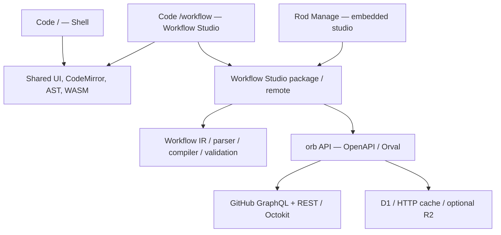
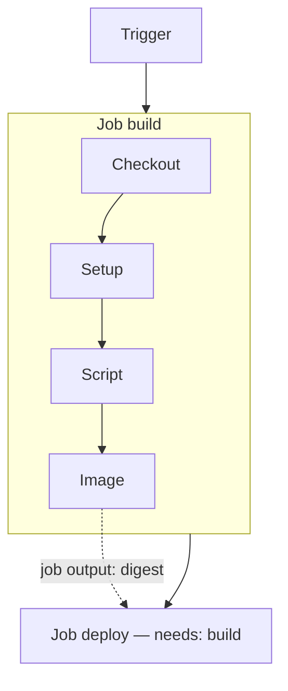
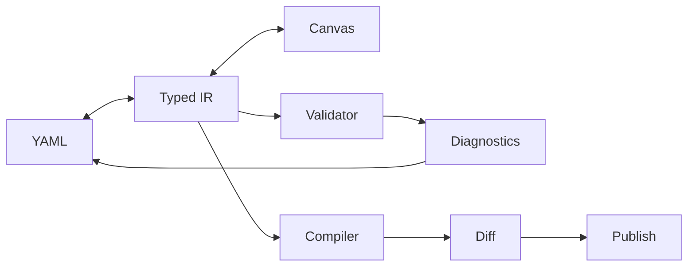
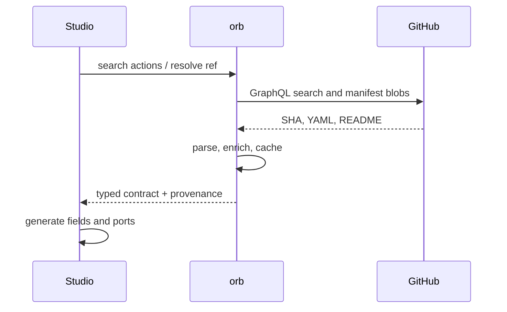

# Code — Engineering specification and agent instructions

Status: approved product direction; implementation pending unless verified in code and CI.
Repository: rodkisten/shell (keep repository name until migration is verified).
Base: main. Product name: Code. Shell is one application, Workflow Studio another.

## Non-negotiable rules
- React + TypeScript, strict types, pnpm workspaces, Tailwind CSS v4, shadcn/ui and Radix primitives. No alternate styling framework, custom replacements for standard primitives, or Monaco. Use semantic design tokens, dark graphite theme, accessible focus and compact responsive layouts; CodeMirror 6 Material Darker.
- Extract reusable components and infrastructure continuously, but avoid speculative abstractions. Apps must not import each other's internals.
- Deliver large vertical slices, not decorative placeholders or fragmented commits. Intermediate commits [skip ci], final [deploy]; use the Rod GitHub App where available. Sync with main, inspect existing PRs, avoid overwriting concurrent work. Include conversation URL in PR when available; never invent it.
- Unit tests with Vitest for parsers, contracts, runtime and utilities; no component/e2e suite unless explicitly requested. Verify build, typecheck, lint and manual preview. Do not claim untested behavior.

## Architecture


## Workspace migration
Target layout:
```text
apps/shell/
apps/workflow/
packages/ui/
packages/codemirror/
packages/shell-runtime/
packages/ast/
packages/workflow-core/
packages/workflow-studio/
packages/workflow-registry-client/
worker/
pnpm-workspace.yaml
pnpm-lock.yaml
```
Audit existing root imports, Vite/Cloudflare plugin, TypeScript aliases, public assets, Go/WASM build scripts, R2 bindings and CI before moving files. Preserve all existing Shell behavior and URLs including /api, /v86, /debian, /install and Eita installer routing. Root becomes workspace orchestration, not an application. Use workspace dependencies and explicit package exports; migrate npm scripts and lockfile atomically, update CI to pnpm frozen lockfile, retain Node >=22. No Turborepo initially. Independent HTML entrypoints/build outputs and lazy assets; /workflow and nested routes must resolve to Workflow app, never Shell fallback. Shared components include resizable panels, dialogs, drawers, toolbars, search, diagnostics, editor adapters and theme. Preserve existing shell runtime and AST behavior. iOS Safari: touch-friendly compact UI, no unintended input zoom or autocapitalization, keyboard navigation and responsive drawers.

## Workflow Studio UX
Five coordinated areas: searchable action registry, React Flow canvas (@xyflow/react), inspector, CodeMirror editor, diagnostics. ELK layout, minimap, zoom, drag/drop, undo/redo, selection, keyboard commands, search and local drafts via IndexedDB/Dexie. Panels resizable; mobile uses drawers. Nodes show action branding, version, input/output ports, status and errors. Separate execution edges from data edges. Jobs are groups; steps ordered within a job. Support triggers (push, PR, schedule, dispatch, workflow_call), action steps, scripts, conditions, matrix, reusable workflows, permissions, environment, artifacts, variables and secrets. No arbitrary graph that cannot compile to GitHub Actions.

## Semantic model and round trip
Use YAML CST/AST (yaml package), not React Flow state as source of truth. IR represents workflow, triggers, jobs, ordered steps, expressions, ports, edges, source ranges and unknown fields. Preserve comments, quoting, expressions and unsupported keys where possible; do not silently discard. Invalid YAML remains editable; keep last valid graph and show stale status. Graph edits patch AST; YAML edits reparse and update graph. Stable IDs, transactions, source maps, undo/redo. Layout metadata separate from executable YAML. Import existing workflows; export native .github/workflows/*.yml without proprietary syntax.


## orb registry and GitHub integration
Use @octokit/graphql, @octokit/auth-app and REST Octokit where GraphQL lacks coverage. Server-side installation auth only; enforce repository authorization and tenant-scoped private caches. Search repository names/descriptions/topics and index known workflow uses; GitHub repository search is not a complete Marketplace index. Resolve owner/repo[/subpath]@ref, local actions relative to repository checkout, and reusable workflow paths. Resolve ref to immutable commit, read action.yml then action.yaml at that SHA using GraphQL repository.object(expression), batch README and metadata. Parse name, description, inputs (required/default/deprecation), outputs, branding, runs. Handle composite, Docker and JavaScript actions; reusable workflow workflow_call has separate typed input/secret/output schema. Cache immutable contracts by repo/path/SHA, revalidate mutable refs, handle pagination, rate limits, backoff, missing manifests and offline cache. D1 metadata, optional R2 for large files, HTTP cache for searches. No private cache leakage.
Enrich from README and source AST only as evidence, with provenance and confidence; manual overrides supported. Manifest inputs/outputs often strings, required does not guarantee runtime enforcement, types/enums/secrets/permissions may be inferred only. Unknown remains unknown. Never execute downloaded action code to discover metadata.

Proposed API: GET /workflows/actions/search, POST /workflows/actions/resolve, POST /workflows/validate, GET /workflows/repositories/{owner}/{repo}/files, POST /workflows/publish, GET execution status/logs. Version OpenAPI contracts, generate Orval client; validate actual orb routes before integration. No browser GitHub App credentials. Port contract: id, description, required, default, type (string/boolean/number/json/secret/file/url/unknown), enum, source, confidence. Runtime strings require explicit conversions; distinguish declared vs inferred vs overridden.

## Validation and scripts
Evaluate @actions/workflow-parser, @actions/expressions, @actions/languageservice and actionlint; verify runtime compatibility, use workers/server where needed. Zod contracts and schema validation, graph cycle detection, duplicate IDs, invalid scopes, missing required inputs, unknown outputs, permissions/OIDC warnings, secret existence metadata, invalid expressions and job dependencies. Same-job output uses steps.ID.outputs.KEY; cross-job requires declared job output and needs.JOB.outputs.KEY. Do not treat artifacts as scalar outputs. Validate continuously with debounce and cancellable workers; diagnostics severity, source range, quick fixes and click-to-focus in graph/editor. Block publishing on definite errors; warnings require review.
CodeMirror 6 shell/YAML/JS extensions, Material Darker, contextual completion, hover docs, AST highlights and exact source ranges. Reuse ShellCheck WASM, existing shell parser and Explain; add TS parser for JS and appropriate validators for other languages as supported. Detect literal GITHUB_OUTPUT writes, mark dynamic outputs unknown, allow explicit contracts. Sandbox local script execution with mocked env and output capture, no real secrets, network or destructive execution by default; WASM is not a full GitHub runner and cannot promise Docker/OIDC/service parity. Show runtime limits.
## Publish and execution
Preview semantic and textual diff, permissions, dependencies, action version changes and generated YAML. User chooses branch/PR or authorized direct commit; check expected base SHA, prevent overwrites, require explicit publish. GitHub App least privilege (contents/workflows as needed, actions read/write for dispatch, PR permissions). Never expose secret values. REST for dispatch, runs, jobs, logs and artifacts; map execution to graph with durations, failure focus and read-only mode. Redact logs, rate-limit polling, support cancellation and SSE where available.
## Microfrontend
Standalone /workflow, embedded Manage /workflows/builder, read-only execution viewer. Export WorkflowStudio, WorkflowCanvas, WorkflowInspector, ActionRegistry, WorkflowDiagnostics, WorkflowDiff, WorkflowExecutionViewer and later ActionBuilder. Host passes repository, ref, path, theme, capabilities, API adapter, navigation/publish callbacks. No implicit shared Zustand store. Workspace package first; evaluate @module-federation/vite for independent remote deployment, React/ReactDOM singleton, compatible editor versions, explicit versioned host contract, trusted remote origin, CSP/CORS, error boundary, lazy loading and rollback. Remote JS is trusted host code; no untrusted remotes. iframe only fallback. Do not require Manage changes for standalone.
## DNS, deployment and previews
Existing wrangler.jsonc on main: Worker shell, shell.migos.club custom domain, disabled preview.shell.migos.club entry, R2 shell-linux-assets / eita-previews and preview Linux assets. Preserve them. /workflow needs no DNS record because DNS is hostname-only. Proposed canonical alias code.migos.club and preview.code.migos.club (verify ownership, existing records and TLS before adding); retain shell.migos.club as compatibility host. Use Workers custom domains managed by Wrangler, not arbitrary CNAMEs to guessed targets. Add aliases only after preview smoke and route isolation; no production DNS cutover until verified. Preserve existing worker-first paths and configure explicit workflow HTML fallback for deep links. Ensure WASM MIME, cache immutable hashed assets, no-cache HTML, correct base URLs and no cross-app service worker takeover. One preview per PR, only latest run, shared workflows, no bot/skip CI loops; preview links in PR comments. Prefer manual Cloudflare deploys where existing cost policy requires. Remote manifest optional on same trusted origin; do not add a new DNS hostname solely for federation. Rollback to previous worker version, keep existing domain and assets. Verify DNS/TLS, root, /workflow, nested routes, installers, WASM and preview before switching canonical links.
## Roadmap and acceptance
1. Workspace migration + isolated /workflow + shared UI/editor/runtime + independent builds; preserve shell behavior.
2. Real registry, IR, import/export, canvas, forms and connections, live validation; usable end-to-end workflow creation without fake results.
3. CodeMirror scripts, AST, output detection, diagnostics, offline drafts and local sandbox.
4. orb API integration, GitHub publish, semantic diff, Manage microfrontend contract and integration.
5. Execution viewer, reusable workflows, composite Action Builder and extract selected steps into composite action with explicit boundary ports; validate replacement.
6. Version analysis, templates and PR semantic graph/debt reports.
Each delivery must be a coherent vertical slice. Fixtures: comments/unknown fields, YAML on key, expressions, composite actions, local paths, reusable workflows, matrices, job outputs, cycles, invalid refs, missing inputs, dynamic outputs, secret redaction, round-trip equivalence. Record actual checks and limitations in PR. No claim of completed implementation until verified.
